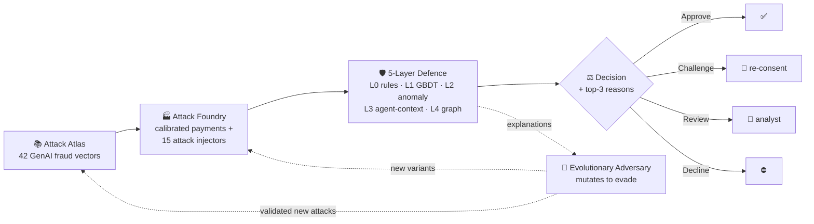

<div align="center">

# 🛡️ MANTIS
### Mandate & Agent Threat Intelligence System

**The trust layer for agentic UPI payments.**
*AI agents are starting to pay on our behalf. MANTIS makes sure they pay safely.*

[](https://aryaambekar-mantis.static.hf.space)


**Team ENIGMA** · Arya Ambekar · Aaryaman Mishra · Arnav Sirse · Vishwakarma Institute of Technology, Pune

</div>

---

## ⚡ MANTIS in 30 seconds

| | |
|---|---|
| **The problem** | Every fraud model in production was trained on payments **a human started**. Agent-initiated payments have **no fraud history, no labels and no detection signatures**. |
| **The insight** | You can't train a defender on data that doesn't exist, **so MANTIS generates it**: a red team that builds the attacks before real attackers do. |
| **The result** | A 5-layer defence that catches **91% of fraud campaigns**, usually by the **2nd payment**, while flagging only **0.1%** of genuine payments. It also recovers on attack types it has **never seen**. |

<div align="center">

| 🎯 **91%** | ⏱️ **2nd** | ✅ **0.1%** | 🧬 **1% → 54%** | 📉 **−39%** |
|:---:|:---:|:---:|:---:|:---:|
| fraud campaigns caught<br>(119 / 131) | payment: typical<br>first alert | genuine payments<br>flagged | recall on a never-seen<br>attack family, after loop training | attacker evasion after<br>adversarial retraining |

<sub>Measured on 1,010,600 payments across 5 independently generated worlds, time-based train/test split. Full numbers in <a href="RESULTS.md">RESULTS.md</a>, written by the run, not by hand.</sub>

</div>

---

## 🚨 Why now

- **UPI is opening up to AI agents.** NPCI is building a **Unified Agent Protocol (UAP)** to register AI agents, verify them and authorise them to transact on UPI, and it demoed agent-led UPI checkout at Global Fintech Fest 2025.
- **Fintechs are shipping agents.** Paytm is rolling out **Paytm Intelligence (Pi)** AI agents for banks, lenders and insurers.
- **Fraud is already expensive, and recovery is broken.** India saw **5.83 lakh digital-payment fraud cases worth ₹3,588 Cr** (FY22 to Sep 2025), and only **~7% was recovered**.
- **The new attacks look like valid payments.** Prompt injection into a shopping agent's cart, mandate abuse, rogue sub-agents and agentic mule rings all pass checks designed for human checkout.

> **Agentic payments created a payment rail with a live fraud surface and zero labelled fraud data.**
> MANTIS generates that data adversarially, then uses it to train a defence that keeps working on attacks it has never seen.

---

## 🧠 How it works: Identify → Generate → Defend → Evolve



### 1️⃣ Attack Atlas: *identify*
A machine-readable catalogue of **42 GenAI-era fraud vectors** in 6 families (agentic mandate attacks, synthetic identity, deepfakes, mule networks, card testing, model evasion). The atlas **drives the code**: `import mantis.foundry.injectors` fails if an implemented card loses its injector.

### 2️⃣ Attack Foundry: *generate*
Builds a **calibrated population of legitimate payments** (customers, merchants, devices, agents, a full calendar) and injects **15 working attack types** into it. The attacks are deliberately realistic: **no attack can be separated by any single raw column** (a hard gate at AUC 0.95).

### 3️⃣ Five-Layer Defence: *defend*

| Layer | What it does | Why it matters |
|---|---|---|
| **L0 · Mandate rules** | 9 deterministic checks: cart outside intent, merchant not allowed, over cap, expired mandate, delegation too deep, invalid consent signature, unregistered agent, provenance mismatch, untrusted domain | Needs **zero training data** and gives a reason you can tell the customer. Maps directly to UAP's questions: *is the agent authorised, within limits, accountable?* |
| **L1 · Gradient boosting** | LightGBM on **232 features** (velocity, mandate, entity, transaction, graph), isotonic-calibrated | The workhorse, with SHAP top-3 reasons on every decision |
| **L2 · Anomaly monitor** | Isolation forest trained on legitimate traffic only | Watches for drift |
| **L3 · Agent-context reader** | Classifies the **text the agent read before it paid** | Catches prompt-injection attacks that look perfectly normal as payments |
| **L4 · Entity graph** | Streaming union-find over users, devices, agents and payees | Exposes mule rings and agent-farm campaigns |

A **learned stacker** fuses the layers, and a **policy engine** maps the score to *Approve / Challenge / Review / Decline*. Thresholds are set as **false-positive budgets**, so a retrain never silently changes how many customers get bothered. **A rule violation always overrides the model.**

### 4️⃣ Adversarial Loop: *evolve*
An evolutionary adversary reads the detector's own explanations, **mutates attacks to evade** (pacing, ring fan-out, device rotation, ticket size, injected pages), and the detector **retrains on everything the arena produces**.

- Mean evasion falls from **0.626 to 0.38** across rounds (**−39%**) and stays down.
- **6 new attack variants** that survived 3+ rounds were automatically written back to the atlas as validated cards (`mantis/atlas/discovered/`).

---

## 🧬 The zero-day result

The question every fraud team asks is *"what about attacks we haven't seen yet?"*

| Scenario | Recall on agentic-mandate family (F1) |
|---|:---:|
| Detector trained **with** F1 data | **0.811** |
| Detector **never** trained on F1 (a true zero-day) | 0.013 💥 |
| Never saw a real F1 event, but trained on **F1 variants generated by MANTIS** | **0.539** 🔁 |

**On a new payment rail you don't have a fraud history, but you can have a red team.** MANTIS shows that attacks which have been described but never observed can be generated, and that training on the generated version carries over to the real one.

---

## 📊 Detection results

| Layer | AUC-PR | ROC-AUC | Recall @ 0.1% FPR | Campaign recall |
|---|:---:|:---:|:---:|:---:|
| L1 · GBDT | 0.590 | 0.925 | 0.450 | 0.916 |
| L3 · Agent-context reader *(no transaction labels)* | 0.169 | 0.692 | 0.138 | 0.214 |
| **Fused** | **0.588** | **0.912** | **0.483** | **0.908** |

<sub>Baseline precision (fraud prevalence) is ~1.09%. No accuracy figures are reported anywhere, on purpose: at 1% prevalence a model that approves everything is 99% accurate. Recall is always reported at a fixed false-positive rate, the way an issuer budgets a review queue.</sub>

**What we're honest about:** unsupervised anomaly detection (L2) barely works on this data, *because we made the attacks realistic on purpose*. That is exactly why MANTIS relies on rules that need no data plus a loop that generates attacks, rather than a cleverer anomaly score. Full analysis is in [RESULTS.md](RESULTS.md).

---

## 🖥️ See it running

**▶ [Open the live console](https://aryaambekar-mantis.static.hf.space)**

Press **Start authorisation stream**. Payments arrive one at a time and are scored in front of you: a risk index, which layers fired, the decision, and the **three features that drove it**. Rows turn red or green when the true outcome arrives.

- **No cheating in the demo:** the scored event and the ground truth are **separate objects on the wire**, so the UI cannot colour a row before the score arrives.
- **Transparent replay:** fraud is over-sampled (~25× its true 1% rate) so something happens while you watch, and the console header says so.
- **Tabs:** Live Console · Results · Attack Atlas · Fidelity

---

## 🚀 Roadmap: beyond detection

Detection is half the job. The next phase turns MANTIS from a detector into a full **Detect → Respond → Recover → Learn** platform:

| | Capability | What it does |
|---|---|---|
| 🔔 | **Smart response** | One-tap *Allow / Block* check with the user in Hindi, English or a regional language, plus an **agent kill-switch** that pauses the agent and freezes its mandate |
| 💸 | **Golden-hour recovery** | Requests a hold on the receiving mule account, files an NCRP / 1930 report, and raises a dispute automatically with an evidence pack (mandate, agent trace, pages read, reasons) |
| 🎚️ | **Self-tightening mandates** | After an incident, suggests a lower cap, fewer allowed merchants, or consent above ₹X, applied with one tap |
| 🪪 | **Know-Your-Agent trust score** | A reputation score per AI agent: trusted agents get fewer OTP prompts, risky ones get more checks. Designed to plug into NPCI's UAP |
| 🕸️ | **Network threat sharing** | Mule accounts and compromised agent platforms found by L4 are flagged across the network: *"This UPI ID was reported."* |

---

## 🛠️ Tech stack

| AI / ML | Data & simulation | Backend | Frontend & ops |
|---|---|---|---|
| LightGBM · scikit-learn · SHAP · NetworkX | Faker · NumPy · Pandas · PyArrow / Parquet · YAML atlas | Python · FastAPI · Uvicorn · SSE · Pydantic | React · TypeScript · Vite · Docker · Hugging Face Spaces · pytest · ruff |

**Runs anywhere:** no network, no GPU, no API key, no Kaggle token.

---

## ⚙️ Quick start

```bash
make install        # editable install + dev tools
make demo           # schema → atlas → corpus → population → dataset → features → L0 → tests
```

Run the console locally:

```bash
make api                                  # terminal 1: backend on :8000 (docs at /docs)
cd web && npm install && npm run dev      # terminal 2: console on :5173
```

<details>
<summary><b>All pipeline stages</b> (click to expand)</summary>

| Command | What it does |
|---|---|
| `make schema` | Prints the frozen `TxEvent` contract (v1.1.0) |
| `make atlas` | 42 vectors, how many have a working injector, and any cards the loop discovered |
| `make corpus` | The committed LLM content corpus, with one example of each kind |
| `make population` | 200k calibrated legitimate payments + calibration figure |
| `make dataset` | Labelled dataset, class balance, per-attack counts, separability table |
| `make probe` / `make derived` | Separability gates on raw columns and on the built feature matrix |
| `make features` | The 232-feature builder, with leakage assertions |
| `make l0` | The 9 deterministic clauses, with per-clause precision and FP rate |
| `make firewall` | All five layers, fusion weights, leave-one-family-out, and writes `RESULTS.md` (~15 min) |
| `make loop` | Evasion curve + zero-day comparison (~30 min) |
| `make ood` | L3 against hand-written injections and benign controls |
| `make feed` | Pre-scores 600 payments for the console (~2 min) |
| `make api` / `make web` | Console backend / React build |
| `make test` | Test suite |

</details>

---

## 📁 Repository layout

```
mantis/
├── atlas/      # 42 attack cards (YAML) + loop-discovered variants
├── foundry/    # calibrated population, attack injectors, LLM content, fidelity
├── defense/    # L0 rules · L1 GBDT · L2 novelty · L3 text · L4 graph · fusion · policy · explain
├── loop/       # evolutionary adversary + retraining arena
├── api/        # FastAPI backend for the console
└── core/       # event schema + paths
web/            # React + TypeScript live console
RESULTS.md      # every reported number, generated by the run
```

---

<div align="center">

**Let AI agents pay. MANTIS makes sure they pay safely.**

Built by **Team ENIGMA** · VIT Pune

</div>
